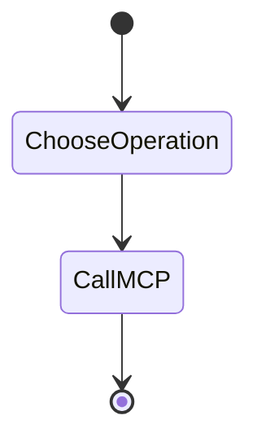

# Workflow



```text
User request
     |
     v
LangGraph agent
     |
     v
MCP client
     |
     | MCP / JSON-RPC 2.0 over stdio
     v
Filesystem MCP server
     |
     +-- read_file
     +-- list_files
     +-- write_file
     +-- search_in_file
     +-- watch_directory
     +-- batch_process
     |
     v
File system
```

The server also exposes `filesystem://root` and `filesystem://files` as MCP resources.
